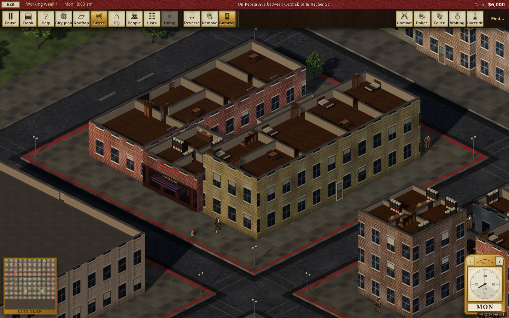

# Illustrated city direction

The remake's detailed city relies on photographed facade and road textures,
3D characters and vehicles, and repeatable building geometry. The result is
legible but does not have the compact, hand-drawn feeling of the 1998 game.
The original game's images are not part of this project.

## First playable comparison

**Game Options → City artwork → Illustrated 1930s (preview)** keeps the
remake's own canvas-painted facades, storefronts, pavement, roof and road.
It requests eight-direction car art, twelve four-direction people silhouettes,
and forty-eight new illustrated portraits. Police wear navy uniforms; federal
agents wear civilian suits and fedoras. Special character actions still use
the existing animated 3D figures. The perspective, simulation, selection and
day/night cycle stay intact. The city style applies when the city next opens.
It is a visual experiment, not a finished replacement art set.

The original illustration sheets are in `art-source/illustrated`; run
`npm run art:people` to rebuild the portrait tiles and street atlas. These
are original assets for this remake, with no graphics from the 1998 game.

Examples: [gang portraits](../art-source/illustrated/portraits-04.png) ·
[police and federal portraits](../art-source/illustrated/portraits-02.png) ·
[street silhouettes](../art-source/illustrated/people-03.png).

## What the prototype reveals

The illustrated textures make the street less photographic. The repeated
building masses, simple window rhythm, small character silhouettes and strong
territory outlines still dominate the image. A convincing 1930s style needs
new art and composition, not only a colour filter.

## Next art passes

1. **Buildings:** draw a small set of distinctive period roofs, storefronts,
   corner buildings and industrial buildings with varied silhouettes. First
   test one residential block and one commercial block at street and rooftop
   zoom. Keep walls and roofs readable at the camera's actual pixel scale.
2. **People:** add drawn walking and action frames to the new directional
   sprites. The first pass holds still images and a slight walking bob; complex
   actions deliberately fall back to the working 3D animation. Keep expanding
   silhouettes and clothing without obscuring faction and role cues.
3. **Street:** redraw the road, pavement, tram and street furniture as a
   coherent palette, with clear separation between walkable space and buildings.
4. **Lighting and overlays:** tune day and night colours around that art; soften
   selection and territory outlines so they do not overwhelm the city.

Keep the first two passes behind the artwork setting until a side-by-side
playtest at both zoom levels shows that people, targets and routes remain easy
to read. New artwork must be created for this remake or separately licensed.
