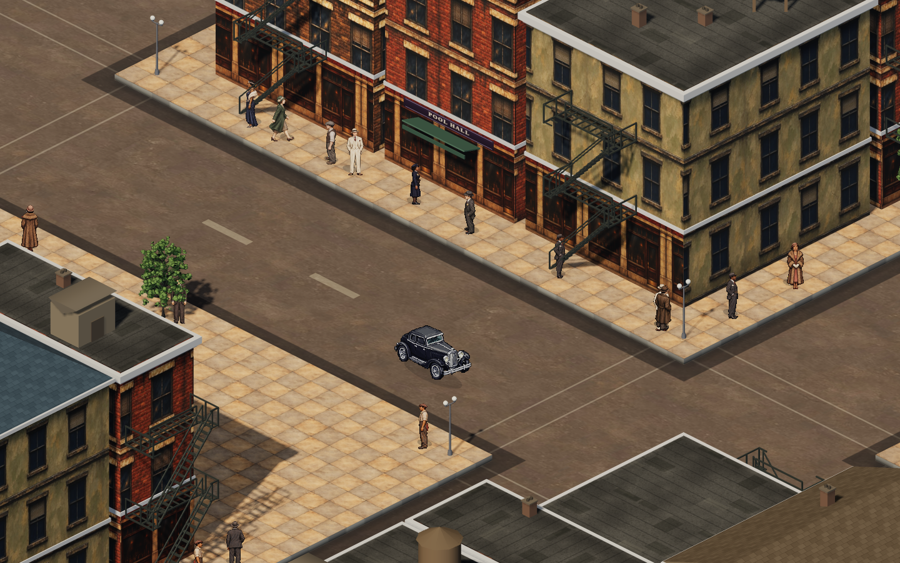
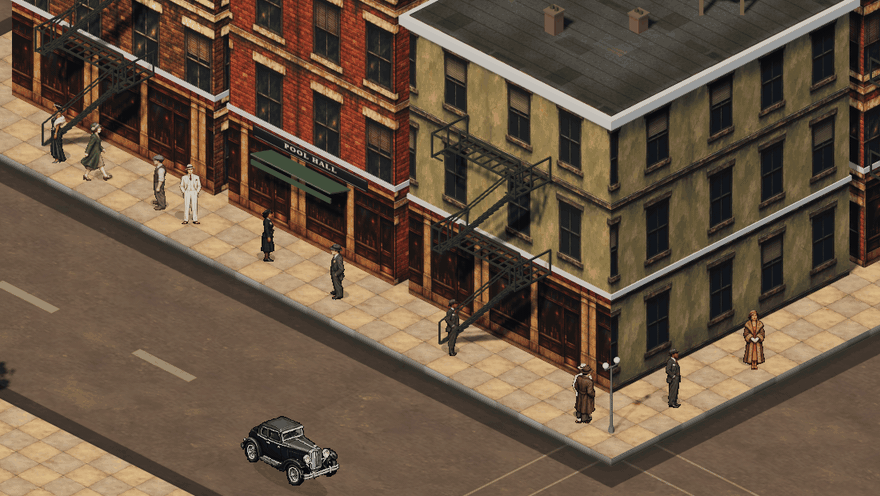
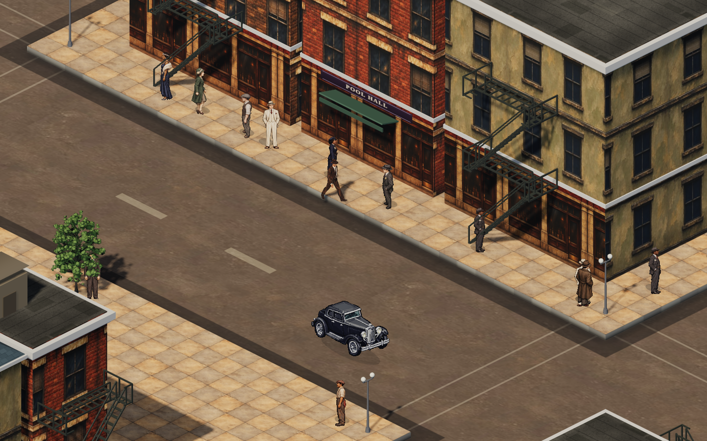
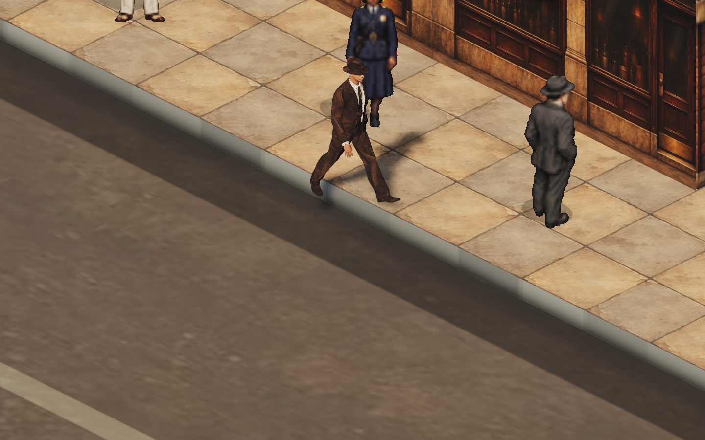

# Illustrated city direction

The remake's detailed city relies on photographed facade and road textures,
3D characters and vehicles, and repeatable building geometry. The result is
legible but does not have the compact, hand-drawn feeling of the 1998 game.
The original game's images are not part of this project.

## First playable comparison

**Game Options → City artwork → Illustrated 1930s (preview)** uses newly
painted red, brown and buff brick facades, limestone and stucco facades, a
storefront, pavement and road.
Other building materials and roofs still use the remake's procedural art.
It requests eight-direction car art, 32 four-direction people silhouettes,
48 painted portraits, and a layered portrait drawing for everyday citizens
and rank-and-file police/FBI. The drawing has 1,536 deterministic identity
seeds, with face shape, skin, hair, hat, clothing, glasses and details; these
are composed variants, **not** 1,536 hand-painted files. The person's saved
ID fixes the same look on reload, including old saves. Skin palette and gender
are shared with the street-sprite selector. Senior officers and crews retain
the painted portraits; their street skin palette follows that painting.

The new street rows include formal evening wear, fur coats, shop staff, work
clothes, the mayor, a judge, a journalist, Black officers, federal investigators,
and more varied everyday pedestrians. A nightclub worker costume is drawn but reserved until
there is an actual worker occupation and schedule in the simulation; regular
venue customers are not silently treated as workers. Special character
actions still use the existing animated 3D figures. The city style applies
when the city next opens. This is a visual preview.

The original illustration sheets are in `art-source/illustrated`; run
`npm run art:people` to rebuild the portrait tiles and street atlas. The
32-row atlas is 512 × 4096 pixels, at the common 4096-pixel texture limit.
These are original assets for this remake, with no graphics from the 1998 game.

Examples: [gang portraits](../art-source/illustrated/portraits-04.png) ·
[police and federal portraits](../art-source/illustrated/portraits-02.png) ·
[street silhouettes](../art-source/illustrated/people-03.png).

## Street-corner review

The second pass tests the illustrated setting in the actual city renderer,
with a commercial corner, a period car and walking citizens, police and FBI.
It uses one fixed city seed and camera position so later art revisions can be
compared at the same scale. The three brick palettes now use painted sheets,
and pale roof props have a warmer finish.
The street and pavement use a shared palette. No images from the 1998 game are
included.

The animation combines four frames from the same running renderer at different
game minutes. The coupe is parked; pedestrians move across the pavement.

The source sheets live in `art-source/illustrated/corner`; run
`npm run art:corner` to rebuild the smaller game textures. For a fresh renderer
capture, run `node scripts/capture-visual-review.mjs docs/images/illustrated-corner-review.png`.
`visual-review.html` is a development preview, outside the normal game menu.
The illustrated material selection itself runs in the game whenever that
artwork option is chosen.

## Painted art on a moving 3D character

The next proof uses the existing fedora man's actual skinned 3D mesh and walk
clip, with a newly painted brown suit and felt hat albedo. The buildings remain
3D, with the illustrated material set above. The surrounding pedestrians and
car in this comparison are still sprites; the brown-suited man immediately
outside the pool hall is the 3D prototype.

This verifies that painted art can wrap around the existing body and move with
its skeleton. It does not convert every illustrated costume into a new body:
fur coats, long dresses and different hats need matching geometry and weights.
The source atlas has many small UV islands, so each new costume also needs a
close inspection for seams and misplaced details.

Run `npm run art:character` to rebuild the 1024-pixel character map. Capture
the proof with `node scripts/capture-visual-review.mjs /tmp/painted-3d.png 0.25 --hybrid`;
add `--close` for inspection, or `--texture=source` for the original albedo.
This person is currently a development preview. The normal artwork option
still uses the delivered street sprites.

For wider 3D adoption, reuse a small set of animated bodies with different
clothes, hats, faces and skin palettes. Preserve the existing visible-rig limit
and simpler distant figures, then measure busy streets before raising it.

## What the prototype reveals

The illustrated textures make the street less photographic. The repeated
building masses, simple window rhythm, small character silhouettes and strong
territory outlines still dominate the image. A convincing 1930s style needs
new art and composition, not only a colour filter.

## Next art passes

1. **Buildings:** draw a small set of distinctive period roofs, storefronts,
   corner buildings and industrial buildings with varied silhouettes. First
   test one residential block and one commercial block at street and rooftop
   zoom. Keep walls and roofs readable at the camera's actual pixel scale.
2. **People:** three common street silhouettes now have four drawn gait frames
   in each of four directions: the brown-coat man, green-coat woman and patrol
   officer. Other figures still have a slight walking bob, and complex actions
   fall back to the working 3D animation. Extend gait coverage to the other
   common costumes, then draw role-specific actions. The layered portraits
   also need a visual quality pass at large UI sizes.
3. **Street:** redraw the road, pavement, tram and street furniture as a
   coherent palette, with clear separation between walkable space and buildings.
4. **Lighting and overlays:** tune day and night colours around that art; soften
   selection and territory outlines so they do not overwhelm the city.

Keep the first two passes behind the artwork setting until a side-by-side
playtest at both zoom levels shows that people, targets and routes remain easy
to read. New artwork must be created for this remake or separately licensed.
