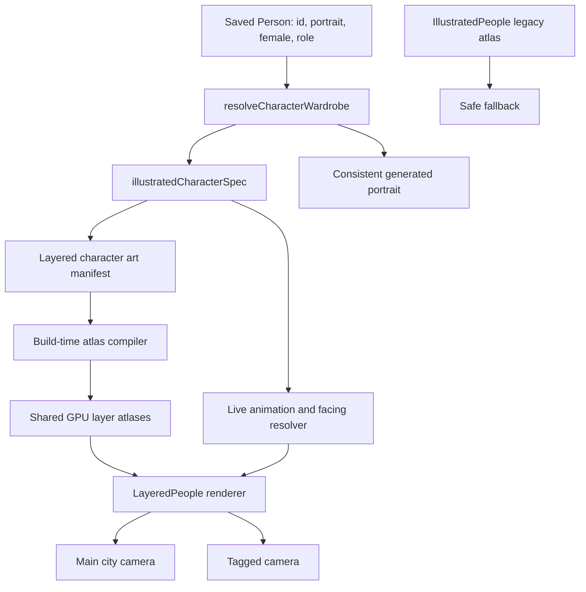
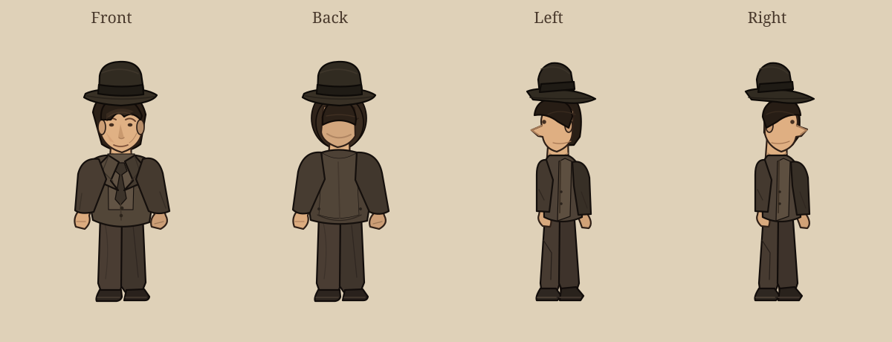

# Illustrated 1930s: layered 2D character renderer (design)

**Status:** Stage 1 complete and Stage 2 male HD pilot implemented behind an
explicit **developer-only** flag. The public `IllustratedPeople` renderer is
unchanged by default. Full role/body/outfit coverage is **not** implemented;
`illustrated3d` remains disabled.

## Decision

Keep the 3D city and RTS simulation, but draw its people as layered, hand-painted
2D paper-doll figures. Share the same deterministic appearance record between
the close-up city sprite and the `Portrait` component. Do **not** build a unique
full-body animated atlas for each of 6,000 citizens and do **not** revive the
broken illustrated-3D skinning path.

### What already exists

- `IllustratedPeople`: 32 fixed costume rows, four facing directions and
  four walking frames. Three walk cycles are painted; other cycles are warped.
  It is production-ready enough to remain the fallback.
- `characterWardrobe`: eight body types, three height scales, 50 outfits, eight
  uniforms, 10 skin colors, 32 face presets, 18 hair options and 18 headwear
  choices. Today this catalog is used mainly by the disabled 3D prototype.
- `PortraitDrawn`: composed SVG faces, presently generated by logic separate
  from the full-body street wardrobe. There is a visual identity mismatch.
- `scene.ts`: chooses the renderer during agent setup and currently depends on
  the concrete `IllustratedPeople` class.

## Architecture

### Stage 1: non-breaking contracts (this PR)

1. Introduce `IllustratedCharacterRenderer` interface so scene code does not
   depend on a specific implementation.
2. Route construction through a factory that returns the **existing**
   `IllustratedPeople` while new artwork is reviewed.
3. Implement a pure `illustratedCharacterSpec(person)` mapping from the
   *already existing* wardrobe catalog to ordered, tintable layer keys.
4. Test determinism, varied 6,000-person population, layer order, roles and
   directional frames. No new save field, shader or texture is activated yet.

### Stage 2: artwork pilot before replacing anything

Author **one high-definition 1930s character** as editable aligned components,
not a single flattened sprite. Use a normal male suit and fedora as the first
test subject; then prove the same sockets work for a heavy/female body before
generating the catalog.

| Asset layer | Responsibility | Shared color |
|---|---|---|
| backHair | Rear hair silhouette | Hair tint |
| bodyLower | Skin-visible legs and feet | Skin tint |
| clothesLower | Trousers, skirt or dress hem | Fabric tint |
| bodyUpper | Neck, arms and visible hands | Skin tint |
| clothesUpper | Coat, jacket, dress, lapels | Fabric tint |
| face | Head shape and facial features | Skin tint |
| frontHair | Forehead and side hair | Hair tint |
| headwear | Hats, caps, helmets; optional | Hat tint |

All layers share an exact *256 × 384 px* logical standing canvas, a ground/feet
anchor, identical directional origin, and normalized joints. Painter supplies
four coherent directions: front, back, left and right. Basic walking uses four
frames per direction (16 poses for each affected part). **These are target
specifications, not files that currently exist.** Reuse left/right by mirroring
only when clothing, asymmetry, weapons and badges remain correct.

For the first review, deliver standing front/back/side + four walking frames
in one direction, then test the alignment with the existing city camera. Only
after approved silhouettes should the rest of the views be produced.

### Stage 3: asset compiler and renderer

- Compile logical keys (e.g. `outfit/m-tweed-suit/upper/front/0`) into UV
  rectangles within paged, power-of-two, transparent texture atlases. Do not
  create one texture file per identity; avoid a 4,096px sheet-size assumption.
- At runtime resolve the person once and **cache by wardrobe signature**, not
  by arbitrary resident ID. Retain a bounded LRU mapping for UV references and
  store tint as per-instance data.
- Use one instanced quad pool per asset page and draw layer, with transparent
  cutout or carefully controlled alpha and deterministic depth ordering.
  Preserve coat/arm overlaps, ground shadows, selected-person ring and depth
  occlusion around buildings.
- Animation API accepts direction/facing, movement phase, held weapon, shooting,
  strike, hit, burn, death, carry and interruption. The sprite artwork must
  depict actual motion; flashing event icons alone is insufficient.
- Camera-facing resolution runs independently for main and Tagged views;
  never reuse camera-specific UVs between the two views.
- **Fallback** automatically to the existing `IllustratedPeople` atlas while
  art downloads, when a specific layer is unavailable, or on graphics errors.

### Stage 4: integrate carefully

- Add the layered renderer as an opt-in developer preview (separate from the
  public `Illustrated 1930s` style). Do not silently change the current
  player-visible option.
- Use **the same wardrobe** for city figure and SVG/generated mugshot, with
  role-appropriate police, FBI and firefighter uniforms. Preserve existing
  painted principal/crew portraits until matching replacements are approved.
- Reuse existing rendering priorities and view culling: only near/important
  characters need full layered detail. Distant pedestrians keep low-cost
  sprites. Six thousand *residents in the simulation* does not mean six
  thousand 3D rigs or unique textures each frame.
- After visual sign-off and regression tests, enable layered renderer for
  `illustrated` and keep the previous atlas as a rollback option.

## Memory/performance budget

A 256×384 RGBA image costs ~384 KiB **per frame** uncompressed. Building 16
full-body frames for each of 6,000 citizens would consume roughly 37.5 GiB
before mipmaps. This is rejected.

Instead share each body/costume/hair/hat **part** by logical key, tint it in the
shader, and draw only visible people. Start with a cap around 32 high-detail
characters as already used for existing 3D rigs, then benchmark and adjust
only against measured timings. Target a smooth 60 fps on the agreed test
hardware with a city of 6,000 inhabitants; no fixed FPS is guaranteed before
profiling. Include texture memory/draw calls/visible count instrumentation.

## Acceptance criteria

- Stable appearance for same saved person on reload and across all camera
  views; two independent saved people can look different.
- Eight builds, three heights, 10 skin shades and 50 outfits exposed through
  `resolveCharacterWardrobe`; uniforms distinguish police, FBI, firefighters.
- Complete aligned standing/walk directions, no disconnected arms/feet or
  appearance changes mid-animation.
- Selecting/targeting a person and doors/building occlusion continue to work.
- Action poses and death/hit states do not revert to a different appearance.
- Portrait matches on-street face/skin/hair/outfit identity.
- 6,000-resident save/load and ordinary city performance are unchanged when
  preview is off; fallback works on missing atlas.
- `visualStyle='illustrated3d'` remains disabled; no modification to existing
  Illustrated Vehicles or previously published beta releases.

## Delivery order

1. Contracts + pure appearance plan (this PR).
2. Painted one-person editable multi-layer proof and in-game gallery/capture.
3. Compiler and compositing renderer behind developer flag.
4. Animation/art extension, portrait unification, performance profiling.
5. Wider gallery and staged rollout into Illustrated 1930s after acceptance.

## Stage 2 actual delivery (23 Nov 2026)

- Editable source artwork: `art-source/illustrated/layered-pilot/{slot}/{front,back,left,right}.svg`, **32 independently editable SVG pieces**. Eight logical layers (hair back, body lower, clothes lower, body upper, clothes upper, face, hair front, hat). Canvas 256×384; aligned ground baseline.
- `scripts/build-layered-pilot.mjs` produces eight PNG atlases and `manifest.json` under `public/art/city/layered-pilot/`. Each atlas has 4 direction rows and 5 columns: one **standing pose plus 4 walk frames**. Source art remains vector; walk arcs use shoulder/hip transforms and alternate foot lift.
- `LayeredPilotPeople` renders the eight layers with per-instance tint through `InstancePool`, independent directional UVs for the main and Tagged cameras, depth ordering, shadow and shared action cue atlas. Failures use the legacy renderer.
- `IllustratedPeopleWithPilot` blends the two renderers: **only the selected male boss, lieutenant or hood** gets the prototype when `?layeredPeople=1`; everyone else uses the same `IllustratedPeople` as before. Selection/picking remains owned by `scene.ts`. This is intentionally a *single male average-build suit and fedora* proof, not 50 finished wardrobe models.
- To review: choose **Options → Illustrated 1930s (preview)**, save/reopen the city, then launch the development build with `?layeredPeople=1` and click a male crew member. Without the flag, the legacy art is unchanged.
- Packaging invokes the SVG→PNG compiler automatically before every `npm run dev` and `npm run build`. The pipeline validates asset dimensions and manifests; tests verify the fallback, renderer counts, idle/walk UVs and editable source inventory.
- Next stages are multiple body templates, matching wardrobe silhouettes, separately drawn action animations, actual in-game portrait parity and benchmarked near/far detail selection. These are *not* yet supplied by this pilot.
